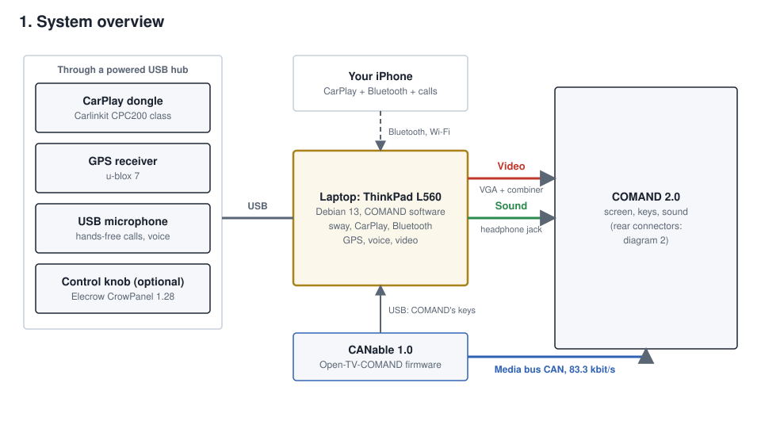

# COMANDiY 2.0

**A do-it-yourself upgrade for the Mercedes-Benz COMAND 2.0 head unit.** It adds Apple CarPlay, Bluetooth calls and
music, AirPlay, internet radio, Plex, YouTube, voice commands and GPS navigation to the car's original screen. You control
everything with COMAND's own knob and keys, so the dashboard looks factory-standard.

> **Please read the [disclaimer](#disclaimer) before you use anything in this repository.** This is a hobby project
> that changes a car's wiring and electronics. You use it entirely at your own risk.

▶ **[Watch it in action on YouTube](https://youtube.com/shorts/F4UXEJyEYzg)**: the Vehicle page and menus on a real COMAND 2.0.

**[Installation and wiring guide](docs/INSTALL.md)**

## What it does

COMAND 2.0 was built before smartphones were common. COMANDiY 2.0 gives it a modern "brain" without replacing the
head unit or cutting into the dashboard:

- **Apple CarPlay**, wired or wireless, through a standard CarPlay dongle.
- **Phone:** hands-free calls and Bluetooth music, with a USB microphone.
- **Music:** AirPlay from any Apple device, internet radio, Plex, YouTube and Music Assistant.
- **Navigation:** a USB GPS feeds Android navigation apps.
- **Voice commands**, processed offline on the computer itself.
- **Sound correction** with an optional measurement microphone.
- **Vehicle page** (optional): live car data such as speed, temperatures, gear, fuel and warning lights, read through
  Home Assistant (see below).
- **Speed-limit warnings** and an optional round knob display.

## How it works

A small Linux laptop hidden in the car does the work. It sends its picture to COMAND's TV input and its sound to the TV
audio input. A CAN bus adapter, running the [Open-TV-COMAND](https://github.com/niz93/Open-TV-COMAND) firmware, makes
COMAND believe a TV tuner is fitted. It also passes COMAND's knob and key presses back to the laptop. Your original
radio, CD, navigation and settings keep working as before.

**Safety by design:** the picture switches off while the car is moving, because COMAND's screen is in the driver's view.
Sound and voice control carry on.

## What you need

### Required

- A Mercedes-Benz with **COMAND 2.0**. Other versions may use different pins.
- A **laptop with Intel graphics and a VGA port**. It was tested on a Lenovo ThinkPad L560 (Intel HD 520). Any laptop
  with similar Intel graphics and a VGA port should work, but none has been tested.
- An **MKS CANable 1.0** USB-CAN adapter with the [Open-TV-COMAND](https://github.com/niz93/Open-TV-COMAND) firmware.
  It switches COMAND into TV mode and carries its keys.
- **Harness parts:** a VGA plug, the sync combiner (one transistor and four resistors), screened cable and a 3.5 mm
  stereo plug.
- **Power:** a 12 V to 20 V laptop car adapter with a fuse.
- A USB stick of 2 GB or more and an internet connection for installing. You also need basic soldering and
  car-electrics skills.

### Optional

| Add | For |
|---|---|
| Carlinkit CarPlay dongle (CPC200 class) | Apple CarPlay |
| USB microphone | Hands-free calls and voice commands |
| USB GPS (u-blox 7) | Navigation and speed-limit warnings |
| Powered USB hub | Several USB devices at once |
| **Home Assistant** | **Vehicle page and car sensors, Music Assistant, picture control from Home Assistant** |
| miniDSP UMIK-1 microphone | Automatic sound calibration |
| Elecrow CrowPanel 1.28" | Round knob display |
| Plex server, IPTV server | Your films and live TV in the Video menu |

### About Home Assistant

Many of the implemented sensors are read through [Home Assistant](https://www.home-assistant.io/). To use them you need
Home Assistant installed and running on the car's network, and it must itself read the car, for example through an OBD
or CAN adapter. This applies to the Vehicle page (speed, engine speed, temperatures, gear, fuel, odometer, battery and
warning lights) and the Music Assistant link. Without Home Assistant the rest works normally; those pages just stay
empty.

**Where to take the CAN feed:** the car's CAN bus can be tapped at the overhead console connections. This also
works on cars without a trip computer.

## Getting started

Follow the steps in order, and **test everything on the bench before you fit it in the car**. Each step is described in
full in the [installation and wiring guide](docs/INSTALL.md).

1. **Read the [disclaimer](#disclaimer)** and the safety notes in the guide.
2. **Collect the required parts.** Add the optional parts only for the features you want.
3. **Install Debian 13** on the laptop, either with the USB-stick builder in `stick/` or by hand (guide, section 2).
4. **Run `./install.sh`** on the laptop. It installs everything and can be run again safely (section 3).
5. **Check on the bench:** plug in the USB devices and run `comand-check`, which lists what it finds (section 4).
6. **Flash the CANable** with the Open-TV-COMAND firmware (section 5).
7. **Build the harness** with the car battery disconnected (section 6):
   - **Video:** VGA to COMAND's RGB input through the sync combiner. **Shield the sync combiner** in a small metal box
     or grounded foil, or the picture may roll or flicker. Connect RGB A.G.
   - **Sound:** the headphone jack to COMAND's TV sound input. **Connect both audio grounds**, pin 03 (right) and pin 12
     (left). With only one, a channel is weak, missing or hums.
   - **CAN:** the CANable to the media bus, pins 17 and 18.
   - **Power:** the laptop's car adapter, fused.
8. **First start in the car**, then pair your phone (sections 7 and 8).
9. **Add optional features** one at a time, such as CarPlay, Home Assistant, Plex or the knob display (section 9).

If something does not work, see the troubleshooting table in section 10 of the guide.

## Project status

This is a working hobby project, tested on **one car** with one COMAND 2.0 and one ThinkPad L560 laptop. It is not a finished
product. The guide lists what is not yet proven, including sleep and wake on car power, other COMAND versions and
other laptops. Expect to troubleshoot and adapt it to your car.

## Not an OceanEdge Systems product

COMANDiY 2.0 is a personal hobby project. It is not related to the business activities of OceanEdge Systems, it is not
an OceanEdge Systems product or service, and it cannot be linked to OceanEdge Systems in any way. OceanEdge Systems
does not sell, support or take responsibility for it.

If you are curious what we do every day, visit **[oceanedgesystems.com](https://www.oceanedgesystems.com/)**.

## Repository layout

| Path | What it is |
|---|---|
| `install.sh` | Installs everything on the laptop. Safe to run again. |
| `stick/make-stick.sh` | Optional: builds a USB installer for Debian on a Mac. |
| `tools/comand-check` | Shows which hardware and services the head unit can see. |
| `config/` | Templates for your settings. All values are empty. |
| `docs/` | The guide and diagrams. |
| `ui/` | The menu on COMAND's screen (`main-menu.html`), its bridge to the car, the keys and the guest remote. |
| `carplay/`, `phone/`, `audio/`, `android/`, `mirror/` | CarPlay, Bluetooth calls and music, radio and sound correction, Android navigation, AirPlay. |
| `car/` | Vehicle page, speed limits, voice commands, video, auxiliary battery, Music Assistant. |
| `l560/` | Laptop parts, written for the L560: power hold on car power, battery care, the video output. |
| `esp32-knob/` | Optional round knob display (Arduino sketches). |

## Disclaimer

**By downloading, installing or using any part of this project, you confirm that you have read, understood and
accepted this disclaimer.**

1. **Use at your own risk.** This project is provided "as is", for hobby and educational purposes, without warranty of
   any kind. You use it entirely at your own risk. You alone are responsible for deciding whether it is suitable for
   your car and for how you install and use it.
2. **You accept the risks.** You acknowledge that modifying a vehicle's wiring, electronics and head unit can cause, among
   other things:
   - damage to the head unit, the car's electrical system or other components;
   - electrical faults, battery drain, overheating or fire;
   - malfunction of other vehicle systems that share the same wiring or data bus;
   - loss of the manufacturer's warranty, and possible effects on your insurance or roadworthiness approval;
   - driver distraction, accidents, injury or death.
3. **No liability.** To the fullest extent permitted by law, the developers and contributors cannot be held responsible
   or liable for any damage, injury, loss, cost, fine or claim of any kind. This includes direct, indirect, incidental
   or consequential damage arising from use or misuse of this project, its software, its documentation or its wiring
   instructions, even if they were advised that such damage was possible.
4. **Drive safely and obey the law.** Never operate the system in a way that takes your attention from the road. Do not
   disable or work around the safety features, such as the picture switching off while the car is moving. Follow all
   traffic laws and vehicle regulations where you drive. Some uses may be illegal in your country.
5. **Get qualified help.** Electrical work on a vehicle should be done by someone with the necessary skills. Disconnect
   the car battery before working behind the head unit. If you are not sure, ask a qualified automotive technician.
6. **No support obligation.** The project may change, stop working or contain errors at any time. There is no promise of
   support, updates or fitness for any particular purpose.
7. **Not affiliated.** This is an independent, personal project, not connected with OceanEdge Systems (see
   [above](#not-an-oceanedge-systems-product)). It is not affiliated with, authorised, endorsed or supported by
   Mercedes-Benz, Bosch, Apple, Google or any other manufacturer or brand named here.

This disclaimer adds to the "Disclaimer of Warranty" and "Limitation of Liability" sections (15 and 16) of the GNU
General Public License in [`LICENSE`](LICENSE). If you do not accept these terms, do not use this project.

## Credits

**A big thank you to [niz93](https://github.com/niz93)** for **[Open-TV-COMAND](https://github.com/niz93/Open-TV-COMAND)**,
the TV tuner emulator for COMAND 2.0 and 2.5. It switches COMAND into TV mode and carries its keys, and it is the
foundation this whole project stands on. Without his project I would never have started on this challenge.

Get the Open-TV-COMAND firmware from that page, and give it a star.

## Licence

GNU General Public License v3.0 or later (`GPL-3.0-or-later`): see [`LICENSE`](LICENSE). You may use, change and share
this software, as long as what you share stays under the same licence and includes its source.

Third-party parts included here, each under its own licence:

- `ui/qrcode.js`: [qrcode-generator](https://github.com/kazuhikoarase/qrcode-generator) 1.4.4 by Kazuhiko Arase, MIT.
- `esp32-knob/*/FreeSans*.h`: GNU FreeFont, converted for Adafruit GFX; GPL v3 with the font exception.
- `ui/video/wlr-gamma-control-unstable-v1.xml`: Wayland protocol, MIT-style licence (notice inside the file).

Mercedes-Benz, COMAND, CarPlay, Android Auto, AirPlay, YouTube, Plex and the other names here are trademarks of their
owners. This project ships none of their logos.

## Privacy

This release holds no accounts, passwords, keys or network addresses. You choose your own during installation.
