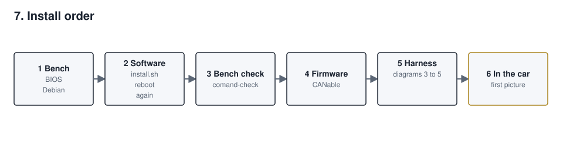
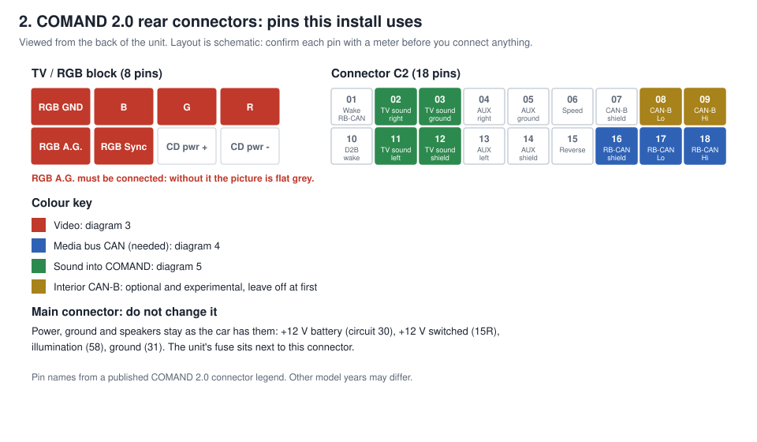
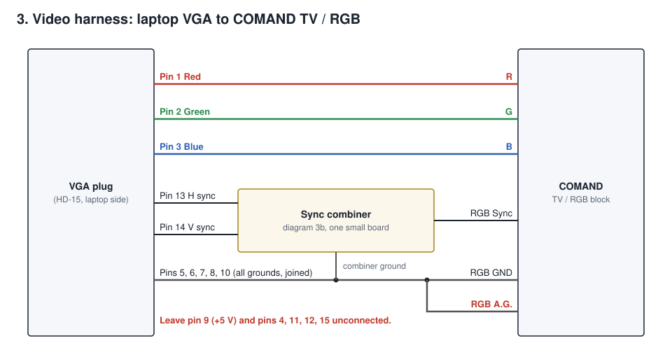
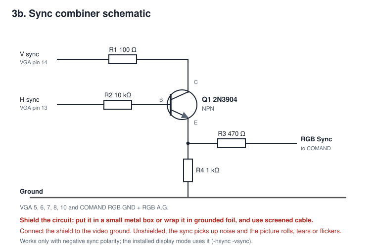
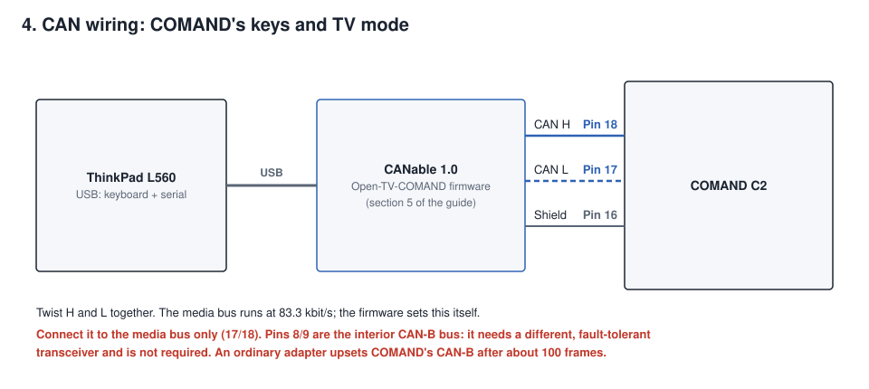
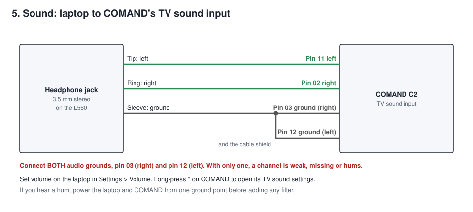
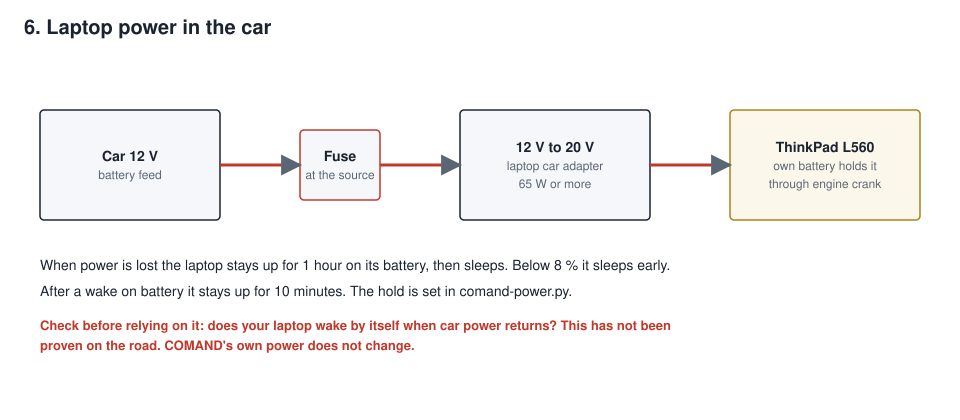

# COMAND head unit: installation and wiring

**Work on the bench first, then in the car.** 



> **Safety.** The picture stops while the car moves, because COMAND's screen is in the driver's view; sound continues.
> Do not defeat this. Disconnect the car battery before you work behind COMAND. A wrong harness can blow the unit's
> fuse. Check every pin with a meter.

## 1. What you need

| Item | Notes |
|---|---|
| Mercedes COMAND 2.0 | Other versions may have different pins. |
| Laptop with Intel graphics and a VGA port | Tested on a Lenovo ThinkPad L560 (Intel HD 520). Any laptop with similar Intel graphics and a VGA port should work, but has not been tested. The video output depends on the VGA port. |
| MKS CANable 1.0 | For COMAND's keys and TV mode. |
| Carlinkit CarPlay dongle | CPC200 class, USB ID `1314:1520`. |
| u-blox 7 USB GPS | |
| USB microphone | For calls and voice commands. |
| Powered USB hub | |
| VGA plug, 2N3904, resistors 100 Ω, 470 Ω, 1 kΩ, 10 kΩ, screened cable | For the harness. |
| 12 V to 20 V laptop car adapter and fuse | Our suggestion; size it for your laptop. |
| Optional: Elecrow CrowPanel 1.28" knob | Firmware source in `esp32-knob/`. |
| A USB stick of 2 GB or more, and internet | |

## 2. Install Debian on the laptop

**In the BIOS** (F1 at the Lenovo logo): Startup > UEFI/Legacy Boot = **UEFI Only**. Secure Boot can stay on.

Connect the laptop's ethernet port to a network with internet.

### With a Mac

1. Copy this folder to the Mac and find the stick: `diskutil list external`
2. Run `stick/make-stick.sh diskN`, with your stick's number. It asks for the user name, password and time zone the
   laptop will have, then asks you to type `YES` before it erases the stick. Only a hash of the password goes on the
   stick. To log in with an SSH key as well, put `KEY=~/.ssh/your_key.pub` in front of the command.
3. Plug the stick into the laptop, press **F12** at the Lenovo logo and pick the stick, then **Install COMAND**.
4. Choose the laptop's internal disk and confirm. **That disk is erased.** Everything else is automatic.
5. Remove the stick when it restarts. The release is now in `~/comand-release`. Skip to section 3.

The stick is pinned to Debian 13.7. If the download fails its checksum, Debian has moved on: use the steps below.

### Without a Mac

Write the standard [Debian 13 netinst image](https://www.debian.org/CD/netinst/) to the stick and install normally:

| Question | Answer |
|---|---|
| Hostname | `comand` |
| Root password | Leave empty, so your user gets sudo |
| User name and password | Your choice |
| Software selection | Only **SSH server** and **standard system utilities**. No desktop. |

Then copy this folder to the laptop, for example to `~/comand-release`.

## 3. Install the head unit software

Log in on the laptop and note its address (`ip -4 addr`), then:

```sh
cd ~/comand-release
./install.sh
```

It asks for the name your phone will see, then downloads and installs for a while. Then:

```sh
sudo reboot
```

> **From this reboot on, the laptop's own screen stays dark** and has no login prompt. This is intended: the picture
> goes to COMAND. Connect from another computer on the same network.

```sh
ssh yourname@<laptop address>
cd ~/comand-release
./install.sh          # second run: downloads the Android image, about 2 GB
sudo reboot
```

If you do not want Android navigation, use `./install.sh --no-android` both times. If something is wrong and you need
the GRUB menu, hold Shift or Esc at power-on.

## 4. Check it on the bench

Plug the USB devices into the hub and run:

```sh
comand-check
```

`[ ok ]` means found; `[ -- ]` means not found. Fix any missing item before going further.

## 5. Flash the CANable

The CANable needs the **[Open-TV-COMAND](https://github.com/niz93/Open-TV-COMAND) firmware by niz93**. All credit for
talking to COMAND's TV input goes to that project. It makes the board look like COMAND's TV tuner, and sends COMAND's keys to the laptop as a USB keyboard. Download it from that page;
it is not included here.

1. Fit the BOOT jumper on the CANable and plug it into the laptop's USB.
2. Flash the `.dfu` file from the firmware's folder:
   ```sh
   dfu-util -a 0 -D <firmware>.dfu
   ```
   The upstream page uses the Windows DfuSe tool for the same job.
3. Unplug it and remove the jumper.

## 6. Build the harness

Do all of this with the battery disconnected. COMAND's rear connectors:



### Video



Build the sync combiner on a small piece of board. COMAND takes one sync line and VGA has two.

**Shield the sync combiner.** Put it in a small metal box, or wrap it in foil, and connect the shield to the video
ground. Use screened cable to and from it. Without shielding, the sync picks up noise from the car and the laptop, and
the picture rolls, tears or flickers.



**Connect RGB A.G.** It is easy to miss, and without it black, grey and white all look the same flat grey.

### CAN



### Sound



**Connect both audio grounds.** COMAND's TV sound input has a separate ground for each channel: pin 03 (right) and
pin 12 (left, also the shield). Connect both to the jack's sleeve. With only one, a channel is weak, missing or hums.

### Power



## 7. First start in the car

1. Reconnect the battery. Start the laptop, then switch on COMAND.
2. Select **TV** on COMAND. The menu appears on COMAND's screen.
3. Turn the knob or use the arrows to move, press to select, **RET** to go back. Hold **RET** for the menu from CarPlay.
4. From a computer on the same network, run `comand-check`.

## 8. Connect your phone

**Bluetooth:** on the phone, pair with the name you chose. Allow contacts and calls when asked.

**CarPlay:** plug the phone into the dongle, or use wireless CarPlay once paired. Choose **Carplay** in the menu.
The phone's first connection can take a few minutes.

**AirPlay:** with the phone on the same network, choose the head unit's name from the phone's AirPlay list.

## 9. Optional features

**Home Assistant.** Many of the implemented sensors are read through [Home Assistant](https://www.home-assistant.io/),
so you need Home Assistant installed and running on your car's network to use them. This covers the Vehicle page
(speed, engine speed, temperatures, gear, fuel, odometer, battery and warning lights), the Music Assistant link and
the picture controls from Home Assistant. Home Assistant must itself read the car, for example through an OBD or CAN
adapter, with entities named `sensor.car_…` and `binary_sensor.car_…` (the prefix is `HA_ENTITY_PREFIX`). Without
Home Assistant everything else works; those pages just stay empty.

**Where to take the CAN feed:** the car's CAN bus can be tapped at the overhead console connections. This also
works on cars without a trip computer.

Settings live in `/etc/default/`. Edit them with `sudo nano`, then run `./install.sh` again. Leave out anything you
do not use; those parts stay off.

| Feature | Where | What to set |
|---|---|---|
| Plex (Menu > Video) | `comand-plex` | `PLEX_TOKEN`, `PLEX_URLS` |
| Vehicle page | `comand-vehicle`, `comand` | `HA_TOKEN`; `HA_URLS`, `HA_ENTITY_PREFIX`. Needs your own Home Assistant that reads the car. |
| Music Assistant | `comand`, `comand-ma` | `HA_HOSTS`, `MA_TOKEN` |
| Picture and Home Assistant link | `comand`, `~/.config/comand/mqtt-pass` | `HA_HOSTS`, `HA_MQTT_USER`, the password |
| Auxiliary battery | `comand-aux` | `DALY_MAC`, `VICTRON_MAC`, `VICTRON_KEY` |
| Speed-limit map updates | `comand` | `MAP_AUTO_UPDATE=1`. Downloads are large. |
| Live TV (Menu > Video) | `comand` | `IPTV_URL`: your IPTV server's line-up API. Without it the menu says Live TV is not reachable. |
| Sound calibration | Settings > Sound > Calibrate | A miniDSP UMIK-1 USB microphone. Fits a correction per speaker; no settings file. |
| Android navigation | Menu > Navigation | Sign in to Google in Android and install your navigation app. |

**YouTube lists** (subscriptions, Watch later) need a sign-in. Single videos and public playlists do not.

1. Open a private browser window, log in to YouTube and open `youtube.com/robots.txt` in that tab.
2. Export the cookies with a browser extension, as `youtube-cookies.txt` in Netscape format, and close the window at once.
3. Copy the file to the laptop as `/var/lib/comand/youtube-cookies.txt` and run `chmod 600` on it.

Treat this file like a password. If the menu says **Sign-in needed**, export it again. To keep YouTube working, update
its helper now and then: `/opt/comand-voice/venv/bin/pip install -U "yt-dlp[default]"`

**Guest remote:** Settings > App control shows a QR code. A passenger on the same network scans it to get volume,
now playing and the music, video and radio lists on their phone. The code in the QR is the only key; show it again to
let a new phone in.

**Battery care:** the laptop lives on car power, so it charges only below 75 % and stops at 80 %, which keeps the cell
from sitting full in a warm car. It switches itself off at 20 % when the car power is gone.

**Picture adjustment:** Settings > Picture on COMAND. Expect to raise brightness and correct a blue cast.

## 10. Troubleshooting

| What you see | Likely cause | What to do |
|---|---|---|
| No picture on COMAND | COMAND not in TV mode, or no sync | Select TV. Check the combiner and pins 13, 14. |
| Flat grey picture, no black | RGB A.G. not connected | Diagram 3. |
| Rolling or torn picture | Sync polarity, combiner or noise | Check Q1's pins and R1 to R4 against diagram 3b, and that the combiner is shielded. |
| COMAND's keys do nothing | CANable not found | `comand-check`. Check pins 17, 18 and the firmware. |
| Installer asks for a Wi-Fi password | No wired link | Check the ethernet cable and start again. |
| CarPlay stays black, phone will not rejoin | Dongle needs a power cycle | Unplug the dongle for 5 seconds. Try not to restart the service often. |
| Android menu stays black | No navigation app installed | Install one in Android. |
| One channel weak, missing or humming | Only one audio ground connected | Connect both pin 03 and pin 12 (diagram 5). |
| No sound | Wiring, or COMAND on another source | Check Settings > Volume, diagram 5, and `pactl list short sinks`. |
| Picture stops while moving | By design | Sound continues. |
| See what a service reports | | `journalctl -u comand-bridge -n 50` |

Do not put `console=ttyN` on the kernel command line: the screen then stays on a login prompt over the menu.

## 11. What has been tested

This software runs on one COMAND 2.0 and L560 with this wiring. Not yet proven:

- Sleep and wake on car power, and the power hold on the road.
- Other COMAND versions. Other laptops: any with similar Intel graphics and a VGA port should work, but none has been
  tested.
- Open-TV-COMAND from upstream with this software: our own unit runs a modified build of it.
- Steering-wheel buttons over CAN-B: not working yet, so they are left out of this guide.
